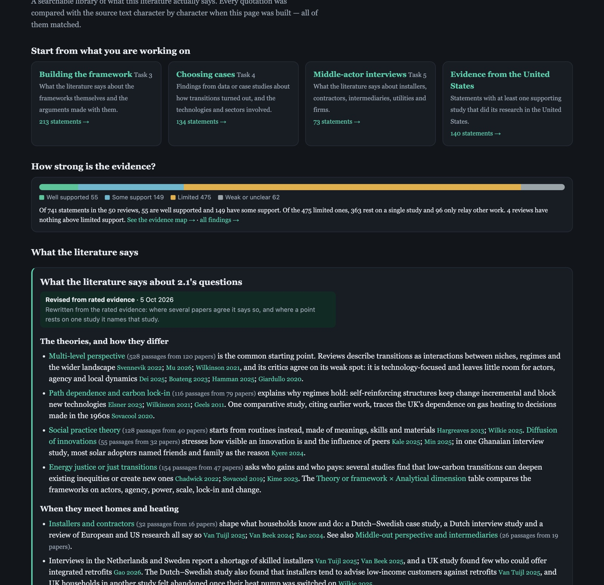
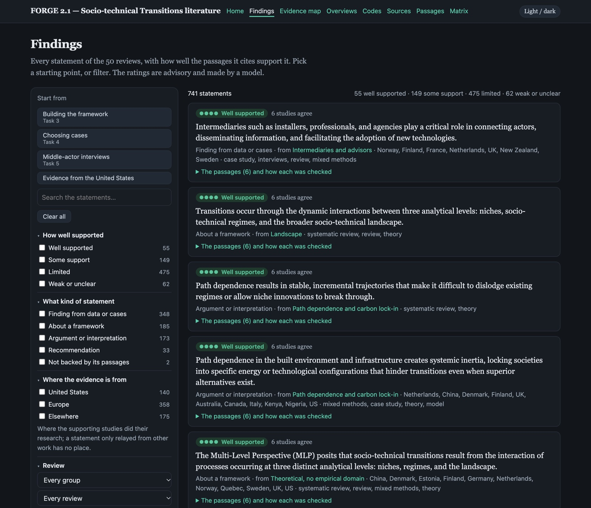
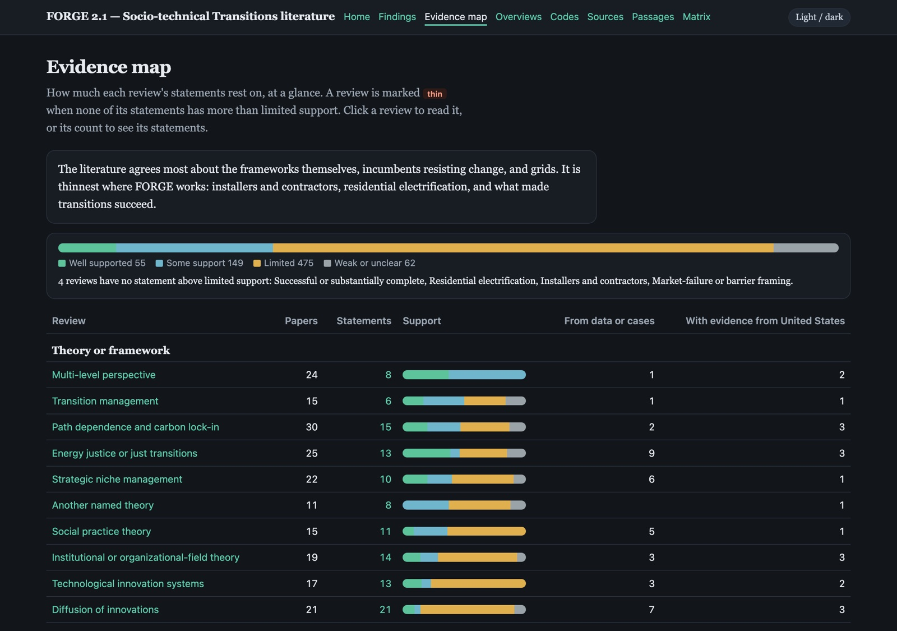
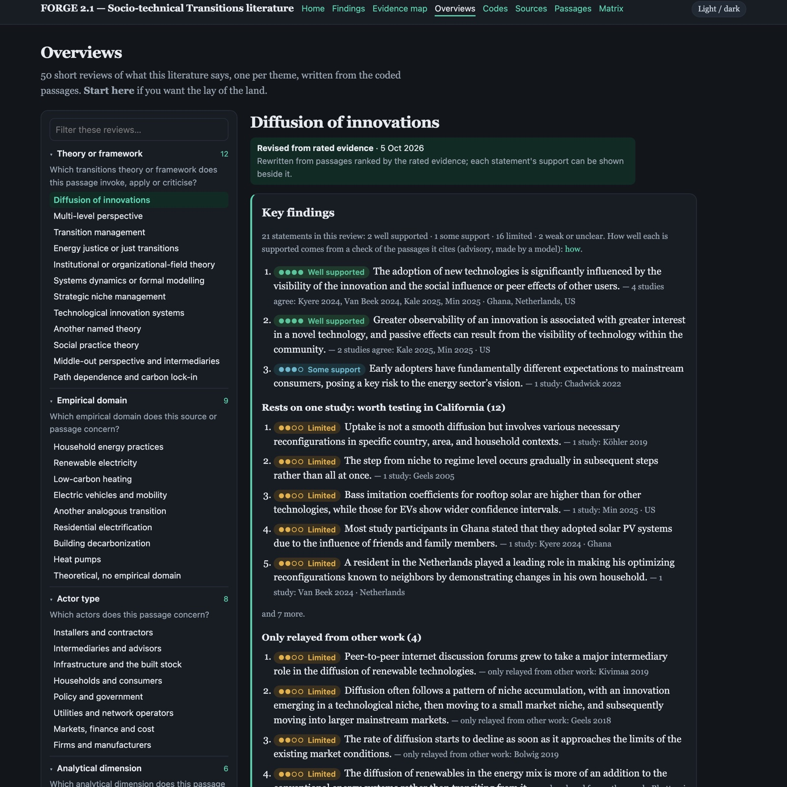
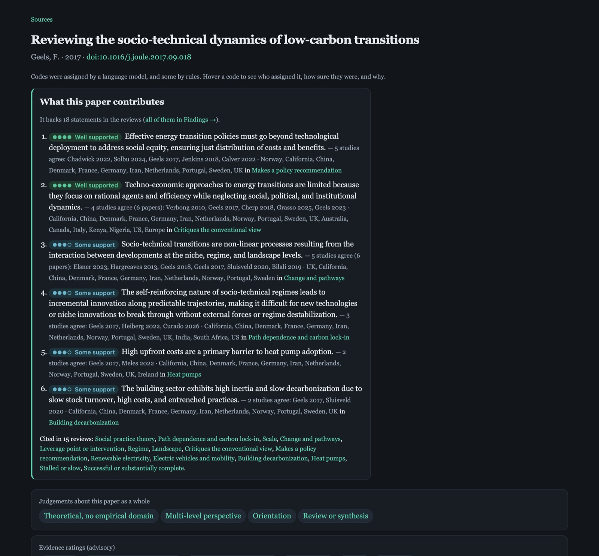
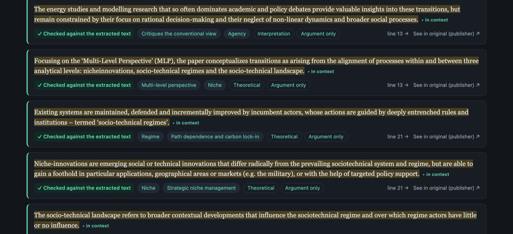

# Universal Provenance Corpus (UPC)

**Turn hundreds of research articles into a coded, evidence-rated library you
can browse and share, in which every quotation is checked against the paper it
came from.**



## For researchers: what this lets you do

You have a large body of literature and a handful of research questions. Reading
everything closely isn't possible, and an AI summary you can't check isn't
worth much. UPC lets language models running on your own computer do the
first pass of reading, coding and rating. You set the questions and codes and
approve each step, and every claim the result makes can be followed back to the
exact sentence in the paper.

1. **Bring in the literature.** Use a folder of PDFs with a spreadsheet that
   lists them, Markdown exports from a literature-review tool, web pages and
   data records you have fetched, or spreadsheets of your own data. Hundreds of
   papers at a time is the normal case. UPC doesn't search databases for you;
   you bring the articles.
2. **Find what's relevant to your questions.** Each paper is screened against
   your research question for how relevant it is and what kind of study it is.
   Then you can ask a question in plain words and get the passages that answer
   it, from every paper at once, found by meaning as well as by keyword.
3. **Code passages.** You write codebooks from your research questions, such as
   theories, actors, technologies or outcomes. A model reads every paper and
   pulls out the passages that fit each code. You spot-check samples, and
   agreement between you and the model is reported. A person's codings and a
   model's sit side by side, each under its coder's name.
4. **Rate the strength of the evidence** at three levels:
   - **Papers** get a grade from a checklist suited to their design. A
     survey, a case study, an engineering model, a grey-literature report and a
     theory paper are each judged by their own field's standards. The checklist
     covers the evidence base, whether the design can support the claims, how
     carefully the study was done, sample and precision, corroboration, and
     transparency.
   - **Passages** are labelled for what they rest on: data, a case, a cited
     study, argument only, or nothing shown. Each is also labelled for whose
     claim it is: the authors' own finding, or one relayed from other work.
   - **Statements** in the written overviews are each checked against the
     passages they cite. Each is shown as *Well supported*, *Some support*,
     *Limited* or *Weak or unclear*, with how many independent studies agree
     and where those studies did their research.

   Citation impact is shown beside a paper's grade and never mixed into it.
5. **See what the corpus holds.** There is a short overview for every code.
   Claims made by several independent studies are grouped together. An
   evidence map shows which themes rest on solid ground and which are thin. A
   home summary gives the lay of the land.
6. **Browse and share it.** All of this becomes a website: a page for every
   paper, code and overview, a searchable index of every passage, a matrix that
   crosses two codebooks, and a Findings page you can filter by support, kind of
   statement and place. It is a single HTML file you can email, and it opens
   with no software. A folder version is available for hosting, and an Obsidian
   vault if you prefer to read in your own notes.

### What the browsable library looks like

These screenshots come from a real 179-paper library on socio-technical energy
transitions.

**Findings:** every statement from the overviews with its support. Filter it,
or pick a starting point written for one of the team's tasks.



**Evidence map:** which themes the literature agrees on, and where it's thin.



**An overview with its Key findings:** what's well supported comes first, then
what rests on a single study, kept separate from what is only relayed from
other work.



**A paper's page:** what the paper contributes to the overviews, how it was
judged as a whole, and its evidence ratings.



**Every passage** with its codes and evidence labels. A tick means the passage
was found word for word in the paper. Each one opens in context, at its place
in the paper or the original PDF.



### Why you can trust what it shows

- **No invented quotations.** The model proposes a quotation, and the software
  checks it character by character against the paper. A quotation that doesn't
  match is reported and never stored. This is what makes a small local model
  safe to use.
- **Every judgement is named.** Each code, screening decision and rating
  records who made it: which model, which rule or which person. Disagreements
  are shown, not hidden.
- **Ratings are advisory, and they say so.** Each rating is run three times and
  settled by majority vote. A "yes" must quote the paper or it becomes "can't
  tell". Agreement between runs and with a blind second coder is reported, and
  a Methods page discloses how AI was used. The rater never sees the venue or
  the citation count.
- **You make the decisions.** You own the codebooks, the rating rubric, and the
  choice of when to run a full pass or publish. The models run on your own
  machines, and nothing goes online until you say so.

### What it took in practice

For the 179-paper library above (4,500 pages, nine codebooks), on two machines
each running a 27B model for reading and a 9B model for quick tasks:

| Step | Time and result |
|---|---|
| Bring in the papers | 24 seconds |
| Screen and code every paper | about 2.5 hours. 3,239 verified passages, 94% of proposed quotations found in the paper |
| Rate every paper, three runs each | 4.5 hours, overnight |
| Rewrite 50 overviews from the rated evidence and check their 741 statements | about 40 minutes |
| Build the site | 12 seconds. 294 pages, every quotation verified |

### What you need

- **The articles**, gathered by you or your search tool.
- **A computer that can run language models locally.** The library above used
  a 27-billion-parameter model for reading and coding, a 9-billion one for
  quick tasks, and an embeddings model for search.
- **Someone comfortable at the command line, or an AI coding assistant.** The
  [runbook](skill/upc-corpus/SKILL.md) is written so that an assistant such as
  Claude Code can follow it step by step, stopping for your decisions.

Start with the toolkit's [overview](skill/upc-corpus/README.md) and
[runbook](skill/upc-corpus/SKILL.md). The rating method and its sources are in
[the rubric](skill/upc-corpus/references/appraisal/rubric.md).

---

## For developers and tool builders: the standard

Underneath the toolkit is **a tool-independent standard for storing research
materials with explicit, portable provenance and byte-exact quotation gates.**
Version **1.15.1**.

A UPC corpus is a folder in which both humans and software can always answer:
*What is this object? Where did it come from? What transformations produced it?
What evidence supports it? What other objects depend on it?* — and, above all,
*is this quotation real?*

It is designed to be **machine-managed, human-browsable, and LLM-renderable to
any format** at the same time — see the three co-equal audiences in
[spec/00-overview.md](spec/00-overview.md).

## The one hard promise

Every quotation attributed to a source is verified by **dumb byte-for-byte
comparison**, at each hop of a chain, or it is flagged:

```
output quote  ==exact==  extraction.direct_quote  ==exact==  representation bytes at the locator
```

No normalization softens the comparison; no heuristic "finds it anyway."
Normalization and cleanup happen when an extraction is *created* (you choose the
span); *verification* is dumb equality. A small language model can lean its whole
trustworthiness on this: if it only emits quotes that pass the gate, it cannot
fabricate one. See [spec/03](spec/03-extractions.md) (extraction ↔ source),
[spec/04](spec/04-generated-and-synthesis.md) (output ↔ extraction), and the
10-step [small-LLM protocol](skill/universal-provenance/references/small-llm-protocol.md).

## The model in one picture

```
SOURCE ──▶ REPRESENTATION ──▶ EXTRACTION ──▶ GENERATION ──▶ SYNTHESIS
```

- **Source** — the primary object (article, PDF, image, dataset), identified once.
- **Representation** — a typed rendering of a source (raw HTML, print-PDF, clean
  Markdown, an image, a transcript, metadata).
- **Extraction** — evidence pulled from a *specific representation* at an exact
  location; a quotation is anchored precisely enough to verify byte-for-byte.
- **Generation** — single-source derived material (summary, rating, translation).
- **Synthesis** — multi-source analysis (literature review, comparison, answer).

Every derived object records what it was derived from, so a synthesis is
inspectable backward to the original source bytes.

Two further objects record *judgements about* that graph rather than material
derived from it ([§12](spec/12-codes-and-codings.md)):

```
CODEBOOK ──defines──▶ code          EXTRACTION ◀──targets── CODING ──by──▶ coder
```

- **Codebook** — a named coding scheme: the vocabulary a coder may apply.
- **Coding** — one coder's judgement that one code applies to one target.

The span and the judgement are deliberately separate objects. An extraction is
content-addressed over its location and text, so two coders who select the same
sentence converge on **one** span — which is exactly why the verdict cannot live
on it. And because a span-level coding must target an `ext-` id, **every coded
passage has already passed the quotation gate before it can be labelled**: a code
can never become a second, ungated way to point at text.

## Corpus at a glance

```text
<corpus>/
  corpus.json                 # root manifest (machine-owned, regenerable)
  sources.csv                 # spreadsheet mirror of sources (a projection)
  extractions.csv             # flattened evidence table (a projection)
  sources/
    <author-year-title>/      # human-readable slug; canonical id is inside source.json
      source.json             # representations, retrieval, bibliographic, provenance
      representations/        # raw.html, clean.md, images/, media/, transcripts/
      extractions.jsonl
      generated/              # <gen-id>.md, <gen-id>.json
  extractions/<set>/          # optional query-driven extraction sets
  syntheses/<id>/             # synthesis.json + generated synthesis.md
  provenance/events.jsonl     # activity journal (L2)
  index.html                  # generated static browser (a projection)
  .upc/                       # tool-private scratch; never a corpus member
```

Per-source is the canonical layout for writers; `corpus.json.sections` is
authoritative, so tools resolve objects by id through the manifest — never by
hard-coding paths. A per-media-type layout is a permitted readable variant
([Appendix A](spec/appendix-a-layout-decision.md)).

## Core principles

1. The unit is an identifiable research object with provenance, not a file.
2. Logical model is canonical; physical layout is manifest-declared.
3. Per-source directories with human-readable slug names.
4. Content-addressed identity + per-tool aliases, by fully specified recipes.
5. A locator is `(representation_ref, typed position)` — never a bare offset.
6. Derived objects carry an `input_digest` and backward links.
7. Structured objects are the single source of truth; every human/consumer format
   is a regenerable projection.
8. Referential **and content** integrity are enforced by a validator.
9. Storage is crash-safe and portable (atomic writes, portable filenames).
10. **Gates are dumb equality; failures are flagged, never absorbed.**

## Conformance levels

- **L0 Readable** — valid `corpus.json` + sources + ≥1 hashed representation each;
  paths contained; portable filenames.
- **L1 Provenanced** — + recomputed ids + typed locators + provenance stamps + CSL
  + **every active `direct_quote` passes the byte-exact gate**. L1 guarantees *no
  unverified quotations in the corpus*.
- **L2 Synthesized** — + generations/syntheses with backward links + `input_digest`
  + hashed outputs + the **output-quote gate** + an activity journal.

See [spec/08-conformance.md](spec/08-conformance.md) for the numbered rule
registry and error-code table; independent implementations can self-test against
`tests/conformance/`.

## Repository layout

| Path | What |
|---|---|
| `spec/` | The normative specification (`00`–`12` + Appendix A). Self-contained. |
| `vocab/vocab.json` | Single source of truth for closed enums; schemas `$ref` it. |
| `schemas/` | JSON Schema (2020-12) for every object type. |
| `examples/` | A minimal corpus and a web-research corpus, regenerated by `examples/build-examples.mjs` with true ids and byte-exact quotes. |
| `tests/` | `selftest.mjs` (library units) and `conformance/` (per-rule fixtures). |
| `crosswalks/` | Field-by-field mappings: pi-forge and ResearchAssistant (adoption); RO-Crate, Web Annotation, PROV, Obsidian (interoperability); BagIt/WARC/Memento/nanopublication (deferral notes). |
| `profiles/` | The UPC RO-Crate profile (`profiles/ro-crate/`) that RO-Crate exports declare via `conformsTo`, and the Obsidian vault profile (`profiles/obsidian/`) that describes the vault an Obsidian export writes. |
| `docs/` | [`adoption-plan.md`](docs/adoption-plan.md) — the living program for putting UPC underneath ResearchAssistant and pi-forge, with the measurements that shaped it. |
| `skill/universal-provenance/` | Portable zero-dep skill: `upc.mjs` CLI, common lib, references. |
| `skill/upc-corpus/` | A Python toolkit that builds, codes, rates and publishes corpora with local language models, driving the CLI (below). Not part of the npm package. |
| `package.json` | Installable, zero-dependency package (`@ellian-eorwyn/upc`, `bin: upc`). |
| `CHANGELOG.md` | Version history. |

> **License:** [PolyForm Noncommercial 1.0.0](LICENSE.md) — free for **any
> noncommercial purpose** (personal, research, education, nonprofits, government).
> Commercial use requires a separate license from the copyright holder.

## Quickstart

Validate a corpus (schema + integrity + the quotation gates):

```bash
node skill/universal-provenance/scripts/upc.mjs validate examples/web-research-corpus
```

Verify the quotations in any output file against the corpus:

```bash
node skill/universal-provenance/scripts/upc.mjs verify-quotes examples/web-research-corpus/syntheses/*/synthesis.md --corpus examples/web-research-corpus
```

Regenerate manifests, CSV mirrors, and the browser; then open `index.html`:

```bash
node skill/universal-provenance/scripts/upc.mjs regen examples/web-research-corpus
```

Bring a quotation's source up in place — the verified span with its context and
line number, plus any advisory page / image-region / timestamp anchor it carries
(add `--format web-annotation` for the W3C Web Annotation form):

```bash
node skill/universal-provenance/scripts/upc.mjs locate <ext-id> --corpus examples/web-research-corpus
```

Export an RO-Crate 1.3 metadata graph, or a W3C PROV-O derivation graph
(deterministic, read-only projections — the corpus objects stay canonical):

```bash
node skill/universal-provenance/scripts/upc.mjs export examples/web-research-corpus --format ro-crate
node skill/universal-provenance/scripts/upc.mjs export examples/web-research-corpus --format prov -o prov.jsonld
```

Read the corpus as an Obsidian vault — one clean Markdown note per source, images
copied in with their descriptions, boilerplate stripped, and every note's origin in
a folded provenance block:

```bash
node skill/universal-provenance/scripts/upc.mjs export examples/web-research-corpus --format obsidian -o /tmp/corpus-vault
```

Unlike the other exports this one is **lossy on purpose** — nav chrome, running
heads and page numbers go, so the note is the content and nothing else — and it says
in each note what it removed. Quotations are still rendered from the representation
bytes at the locator and still carry their gate badge, so stripping the body cannot
change what a quotation claims.

Put documents *into* a corpus. UPC reads no PDFs and fetches nothing — what a
document is made of is the tool's business — but identity and layout are not, so
`add` does the hashing, minting, slugging and journalling for a producer written
in any language:

```bash
echo '{"title":"A paper","source_kind":"document",
       "files":[{"path":"/abs/paper.pdf","role":"document_pdf","media_type":"application/pdf"},
                {"path":"/abs/paper.txt","role":"text","media_type":"text/plain","parent":0}]}' \
  | node skill/universal-provenance/scripts/upc.mjs add source --corpus <corpus>
```

Let a model propose quotations and have the tool decide which are real. With
`--normalize`, a span the model retyped with straight quotes, a joined line break
or an expanded ligature is still located — and what gets **stored** is the
document's own characters, never the model's:

```bash
echo '{"quote":"the span the model believes is there","type":"passage"}' \
  | node skill/universal-provenance/scripts/upc.mjs anchor --corpus <corpus> --rep <rep-id> --normalize
```

Publish the corpus as a static site for people who have a question about the
literature rather than about the corpus — code pages, per-source pages carrying
the reading copy with every passage highlighted in place, a searchable passage
index, and rendered overviews:

```bash
node skill/universal-provenance/scripts/upc.mjs export <corpus> --format site -o /tmp/corpus-site --bundle
```

It is a pile of files, not an app: no fetch, no router, no CDN, so it works from
`file://`. `index.html` (above) stays what it always was — the surface for
checking whether a corpus holds up; this one is for handing to a colleague.

A folder is not what gets emailed, though, and detached from its siblings that
site's index page is a set of dead links. So the same library also builds as **one
self-contained file** — stylesheet, data, reading copies and all — which opens
from a USB stick with nothing else beside it:

```bash
node skill/universal-provenance/scripts/upc.mjs export <corpus> --format site-one -o library.html
```

`--no-text` drops the embedded reading copies, which are most of the weight: for a
178-paper corpus, 21 MB becomes 4.7 MB and every passage, code and overview stays.

Rebuild the examples and run the tests:

```bash
node examples/build-examples.mjs
node tests/selftest.mjs
node tests/conformance/build-fixtures.mjs && node tests/conformance/run-conformance.mjs
```

## Adopting UPC in a tool

Read the crosswalk for your tool ([pi-forge](crosswalks/pi-forge.md),
[ResearchAssistant](crosswalks/research-assistant.md)); it maps your existing
schema field-by-field to UPC and lists the changes to apply. Drop the
`skill/universal-provenance/` directory into your skills folder to get the CLI;
emit objects per the schemas; run `upc validate`.

Any conformant corpus can then be projected into the wider research-object
ecosystem — `upc export … --format ro-crate` emits an [RO-Crate
1.3](crosswalks/ro-crate.md) metadata graph conforming to the [UPC RO-Crate
profile](profiles/ro-crate/profile.md), with [Web Annotation](crosswalks/web-annotation.md)
selectors and [PROV](crosswalks/prov.md)-mappable derivation. What each level
mechanically guarantees — and, deliberately, what it does not — is stated in
[spec/11-guarantees.md](spec/11-guarantees.md).

## Building corpora with local models

`skill/upc-corpus/` is a toolkit that does the work around the standard, with language
models running on your own machines: PDFs, Markdown bundles or spreadsheets in;
quote-checked passages, codings, screening, search, overviews and the reader's site out. It
also rates the evidence: a grade per paper from a design-specific checklist, whose claim
each passage makes and what backs it, and whether each overview statement is supported by
the passages it cites, three runs per item with a majority vote, every rating labelled
advisory and model-made. Overviews can then be revised from the rated evidence, and the
site gains a Findings page, an evidence map and a Methods page.

The model proposes; the CLI decides. A quotation the model half-remembered fails to anchor
and is reported, never stored, so a small local model is safe to use.

```bash
pip install -r skill/upc-corpus/requirements.txt
cp skill/upc-corpus/config.example.json ~/.config/upc-corpus/config.json   # then edit: where your model servers are
python3 skill/upc-corpus/scripts/preflight.py --corpus <corpus>
```

[`skill/upc-corpus/SKILL.md`](skill/upc-corpus/SKILL.md) is the runbook, one task per
section, and [`skill/upc-corpus/README.md`](skill/upc-corpus/README.md) the overview.

## License

[PolyForm Noncommercial License 1.0.0](LICENSE.md) — free for **any noncommercial
purpose** (personal use, research, education, nonprofits, public institutions).
Adopt the standard, implement it, fork it, extend it, share it, all at no cost.
**Commercial use requires a separate license** from the copyright holder;
`SPDX-License-Identifier: PolyForm-Noncommercial-1.0.0`.
